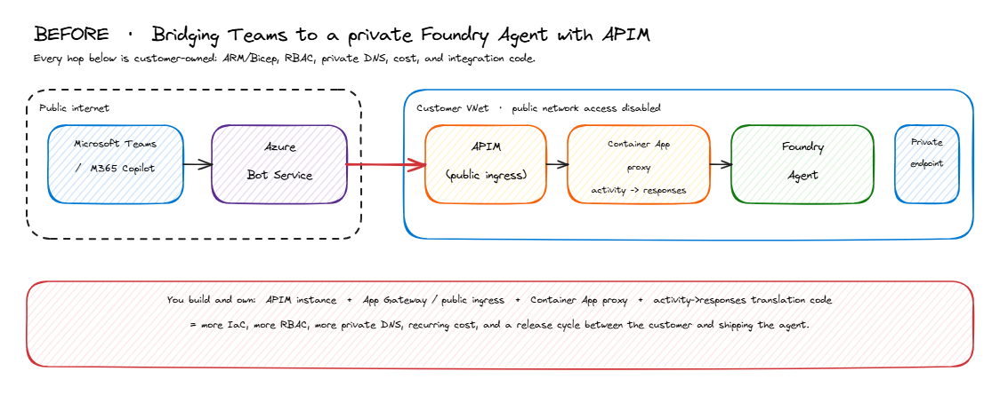
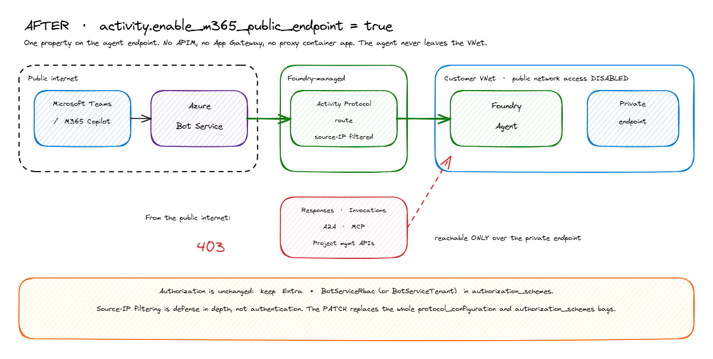
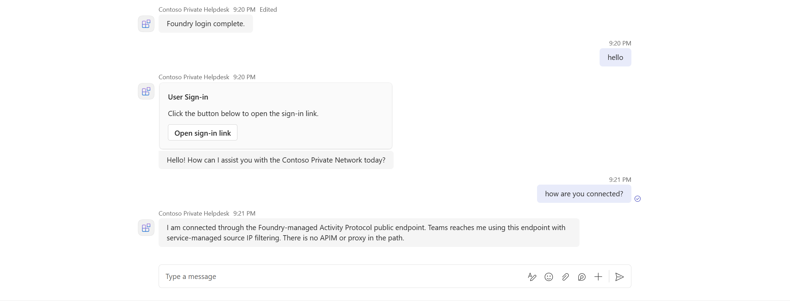

# Publish a private-networked Foundry Agent to Microsoft Teams — without APIM

A complete, runnable reference for publishing a **Microsoft Foundry Agent that lives behind a
private endpoint** to **Microsoft Teams and Microsoft 365 Copilot** — using one property,
`activity.enable_m365_public_endpoint`, instead of an APIM / App Gateway / proxy-container-app chain.

Public network access on the Foundry account stays **disabled**. Only the Activity Protocol route
is opened to Microsoft 365 traffic, using Foundry-managed source-IP filtering. Everything else —
Responses, Invocations, A2A, MCP, and the project management APIs — stays private.

Includes ARM/Bicep templates, seven numbered PowerShell scripts, and a
[12–15 minute customer demo script](docs/demo-script.md).

---

## The problem

Teams and Microsoft 365 Copilot do not support private networking. They require the agent endpoints
they invoke to be routable over the public internet. Bridging that gap used to mean building and
owning a chain of Azure resources:



## The change



```jsonc
{
  "agent_endpoint": {
    "protocol_configuration": {
      "responses": {},
      "activity": { "enable_m365_public_endpoint": true }
    },
    "authorization_schemes": [
      { "type": "Entra" },
      { "type": "BotServiceRbac" }
    ]
  }
}
```

---

## Scope — set expectations early

**This solves**

- Publishing a Foundry Agent to Teams / M365 Copilot while the Foundry account keeps public network
  access disabled
- Removing APIM, Application Gateway and the proxy container app when their *only* job was bridging
  Microsoft 365 to a private agent
- Keeping Responses, Invocations, A2A, MCP and project management APIs reachable only over the
  private endpoint

**This does not solve**

- Making Teams itself private. Teams and Microsoft 365 remain public-network products. No Foundry
  setting changes that — reset this expectation in the first conversation
- Custom public-to-private ingress, non-Teams surfaces, or genuine API management. Those are still
  APIM scenarios
- Authorization. Source-IP filtering is a network control, not authentication

> [!IMPORTANT]
> Keep `BotServiceRbac` or `BotServiceTenant` in `authorization_schemes`. The network exception
> changes **reachability**, not **authorization**. Requests from an allowed service range must still
> pass Bot Service or Microsoft Entra token validation, tenant checks and RBAC.

> [!TIP]
> Need **more than one agent** behind that endpoint? See
> **[multi-agent/](multi-agent/)** — the same zero-trust posture with a chat-facing orchestrator
> that delegates to three specialist sub-agents over A2A, entirely inside the VNet.

---

## Prerequisites

| Requirement | Detail |
| --- | --- |
| Azure subscription | With rights to create Cognitive Services / AIServices and Bot Service resources |
| Existing VNet | With a subnet available for the private endpoint |
| Roles | **Foundry User** on the project, plus **Azure Bot Service Contributor** (or Contributor/Owner) on the resource group |
| Jump box | A VM in the VNet, VPN, or ExpressRoute — needed once public access is disabled |
| Tooling | Azure CLI ≥ 2.60, PowerShell 7+ |
| Resource provider | `Microsoft.BotService` registered |

> [!NOTE]
> The Foundry RBAC roles were renamed. **Foundry User / Foundry Owner / Foundry Account Owner /
> Foundry Project Manager** were previously *Azure AI User / Azure AI Owner / Azure AI Account
> Owner / Azure AI Project Manager*. In a tenant where the rename has rolled out, the old names
> fail outright with `Role 'Azure AI User' doesn't exist`.

---

## Setup and deploy — full walkthrough

Total time: **~30 minutes**. Steps 1–6 can be run from anywhere; step 7 onward assumes public
access is disabled, so run those from inside the VNet.

### Step 0 — Clone and configure

```powershell
git clone https://github.com/sureshpaulraj/foundry-private-agent-teams.git
cd foundry-private-agent-teams

Copy-Item scripts/00-variables.sample.ps1 scripts/00-variables.ps1
```

Edit `scripts/00-variables.ps1` with your subscription, tenant, resource group, VNet and a
**globally unique** Foundry account name. This file is gitignored — it never gets committed.

```powershell
az login
az account set --subscription "<your-subscription-id>"
az provider register --namespace Microsoft.BotService
```

### Step 1 — Deploy the Foundry account, project and model

```powershell
az group create -n <resource-group> -l eastus2

az deployment group create -g <resource-group> `
  --template-file infra/foundry.json `
  --parameters accountName=<globally-unique-name>
```

Creates an AIServices account with `allowProjectManagement`, a project, and a `gpt-4.1-mini`
GlobalStandard deployment. Public network access starts **Enabled** so you can configure the agent;
step 7 turns it off.

### Step 2 — Grant yourself data-plane access

```powershell
$scope = az cognitiveservices account show -n <account> -g <rg> --query id -o tsv
$me    = az ad signed-in-user show --query id -o tsv

foreach ($r in "Foundry User", "Foundry Project Manager") {
  az role assignment create --assignee-object-id $me --assignee-principal-type User `
    --role "$r" --scope $scope
}
```

Wait a minute or two for the assignments to propagate before the next step.

### Step 3 — Create the agent

```powershell
./scripts/01-create-agent.ps1
./scripts/02-get-agent-identity.ps1     # copy the ClientId it prints
```

> [!TIP]
> `POST /agents/{name}/versions` requires the agent body wrapped in a **`definition`** object.
> Omitting it returns `400 invalid_payload — Required property 'definition' is missing`.

### Step 4 — Add the private endpoint and DNS

```powershell
az network vnet subnet create -g <vnet-rg> --vnet-name <vnet> -n snet-pe `
  --address-prefixes 10.0.1.0/24

az deployment group create -g <resource-group> `
  --template-file infra/private-endpoint.json `
  --parameters accountName=<account> `
               vnetResourceGroup=<vnet-rg> `
               vnetName=<vnet> `
               subnetName=snet-pe
```

Creates the private endpoint plus the three required zones —
`privatelink.services.ai.azure.com`, `privatelink.openai.azure.com`,
`privatelink.cognitiveservices.azure.com` — linked to your VNet.

> [!TIP]
> `az network private-endpoint create` has no `--vnet-resource-group` flag. When the VNet lives in
> a different resource group, pass the **full subnet resource ID** to `--subnet`.

### Step 5 — Deploy the Bot Service

```powershell
./scripts/03-deploy-bot.ps1 -MsaAppId <client-id-from-step-3>
```

Creates an `azurebot` with `publicNetworkAccess: Disabled`, `msaAppType: SingleTenant`, and the
Microsoft Teams channel enabled. Its endpoint is the agent's Activity Protocol URL. Copy the
**Bot ARM ID** it prints.

### Step 6 — Enable the M365 public endpoint, then publish

```powershell
./scripts/04-enable-m365-endpoint.ps1 -PinVersion -Version 1
./scripts/05-publish-to-m365.ps1 -BotServiceArmId "<bot-arm-id-from-step-5>"
```

A successful publish returns a `titleId` and a `teamsAppId`.

> [!WARNING]
> The PATCH in step 04 **replaces** `protocol_configuration` and `authorization_schemes` wholesale.
> Every protocol and scheme the endpoint must retain has to be in the body — anything you omit is
> dropped, including `responses` and `Entra`. The script sends the full set; keep it that way if
> you customise it.

Match the scheme to the scope you intend to publish with:

| `publishScope` | Visibility | Authorization scheme | Admin approval |
| --- | --- | --- | --- |
| `Shared` (or `Personal`) | Only you — under **Your agents** | `BotServiceRbac` | Not required |
| `Tenant` | Whole org — **Built by your org** | `BotServiceTenant` | Required in M365 admin center |

### Step 7 — Go private and verify

```powershell
./scripts/06-toggle-public-access.ps1 -Mode Private
Start-Sleep -Seconds 40

./scripts/07-verify.ps1                # from your laptop  -> expect 403 / 403
# then from a VM inside the VNet       -> expect 200 / 200
```

### Step 8 — Confirm in Teams

Open Teams → **Apps** → **Your agents** → your published agent, and ask:

```text
How are you connected?
```

It should describe the Foundry-managed Activity Protocol route with no APIM in the path — while
the Responses protocol is still returning `403` from the public internet.



---

## What correct looks like

| Test | From public internet | From inside the VNet |
| --- | --- | --- |
| DNS resolution | public CNAME chain | → `privatelink` zone → private endpoint IP |
| TCP 443 | n/a | succeeds to the private endpoint IP |
| `GET /agents/{name}` | **403** | **200** |
| `POST .../openai/responses` | **403** | **200** |
| Teams conversation | **works** | works |

The last row is the point of the pattern: Teams keeps working from the public internet while every
other public path is closed.

---

## Running the demo

See **[docs/demo-script.md](docs/demo-script.md)** — six scenes, 12–15 minutes, with the objection
handling table for the questions you will actually get.

The strongest live beat is toggling network access mid-demo:

```powershell
./scripts/06-toggle-public-access.ps1 -Mode Public    # laptop test -> 200
./scripts/06-toggle-public-access.ps1 -Mode Private   # laptop test -> 403
```

Teams keeps answering across both, with **no re-publish and no agent change** —
`enable_m365_public_endpoint` simply goes dormant while public access is on.

---

## Repository layout

```
infra/
  foundry.json              ARM   - Foundry account + project + model deployment
  private-endpoint.json     ARM   - private endpoint + 3 privatelink DNS zones
  bot-service.json          ARM   - Azure Bot Service + Teams channel
  bot-service.bicep         Bicep - equivalent of the above
scripts/
  00-variables.sample.ps1   Copy to 00-variables.ps1 and fill in (gitignored)
  01-create-agent.ps1       Create the agent and its first version
  02-get-agent-identity.ps1 Print instance_identity.client_id + activity endpoint
  03-deploy-bot.ps1         Deploy Bot Service + Teams channel
  04-enable-m365-endpoint.ps1   <- the PATCH that replaces APIM
  05-publish-to-m365.ps1    Publish to Teams / M365 Copilot
  06-toggle-public-access.ps1   Flip PNA on/off for demos
  07-verify.ps1             Public vs private reachability checks
diagrams/                   Excalidraw sources + rendered PNGs
docs/demo-script.md         Customer demo script
multi-agent/                Multi-agent A2A orchestration behind the same private endpoint
  README.md                 Architecture, data flow and component diagrams
  SETUP.md                  Ten-step build + troubleshooting
  scripts/                  Sub-agents, incoming A2A, connections, orchestrator, publish
  diagrams/                 Excalidraw sources + rendered PNGs
```

Diagram sources are editable at [excalidraw.com](https://excalidraw.com) (or your internal instance).

---

## Going further — more than one agent

This walkthrough publishes a single agent. **[multi-agent/](multi-agent/)** keeps the same
zero-trust posture and puts a multi-agent system behind it: one chat-facing **orchestrator** that
delegates to **extractor**, **validator** and **approver** sub-agents over the
[A2A protocol](https://a2a-protocol.org/latest/). To the user it is one agent in Teams; behind the
endpoint it is four.

The delegation runs **server-side, inside Foundry** — which is the part that matters. Teams invokes
the Activity Protocol endpoint, so orchestration living in a local client process would never run.

It also documents two failures that are easy to lose an afternoon to:

- **Publishing rotates the agent identity.** The published agent gets a brand-new identity with no
  role assignments, and every A2A call then fails with `Failed to fetch agent card: 404` even though
  the card is fine. The new identity needs **Foundry Agent Consumer** on the project.
- **Never set an agent card path for a Foundry-agent target.** Foundry resolves its own; supplying
  one returns `Agent card path is invalid for a Foundry agent`.

Start with **[multi-agent/SETUP.md](multi-agent/SETUP.md)**.

---

## Troubleshooting

| Symptom | Cause | Fix |
| --- | --- | --- |
| `Role 'Azure AI User' doesn't exist` | RBAC rename rolled out in the tenant | Use `Foundry User` / `Foundry Project Manager` |
| `400 invalid_payload — 'definition' is missing` | Version payload not wrapped | Wrap the agent body in a `definition` object |
| Toggled PNA to Enabled but still `403` | `networkAcls.defaultAction` still `Deny` | Set `defaultAction` to `Allow`, or add your client IP |
| Teams stops responding after a config change | PATCH dropped `activity` or the Bot Service scheme | Re-send the **full** `protocol_configuration` and `authorization_schemes` |
| `version already exists` on publish | `appVersion` reused | Increment `appVersion`; to roll out agent changes, update the version receiving traffic instead |
| `401` when invoking the endpoint | Wrong token audience | Request a token for `https://ai.azure.com` |
| Publishing fails — agent has no identity | `agent.identity` is null | See the Agent Applications migration guide |
| Tool calls fail inside the agent | Agent identity lacks downstream RBAC | Grant the agent identity roles on the resources it calls |

> [!CAUTION]
> Publishing to Microsoft 365 and Teams means those services process and store publishing metadata
> and agent responses under Microsoft 365 terms. Confirm this fits the customer's compliance, data
> residency and governance requirements before publishing.

---

## Clean up

```powershell
az group delete -n <resource-group> --yes --no-wait
```

Also remove the `snet-pe` subnet if you added it to a shared VNet.

---

## References

- [Configure and share your Microsoft Foundry agent](https://learn.microsoft.com/azure/foundry/agents/how-to/configure-agent)
- [Publish agents to Microsoft 365 and Teams by using the REST API](https://learn.microsoft.com/azure/foundry/agents/how-to/publish-copilot-virtual-network)
- [Publish agents to Microsoft 365 Copilot and Microsoft Teams](https://learn.microsoft.com/azure/foundry/agents/how-to/publish-copilot)
- [Migrate from Agent Applications to the new agent model](https://learn.microsoft.com/azure/foundry/agents/how-to/migrate-agent-applications)

## License

[MIT](LICENSE)
