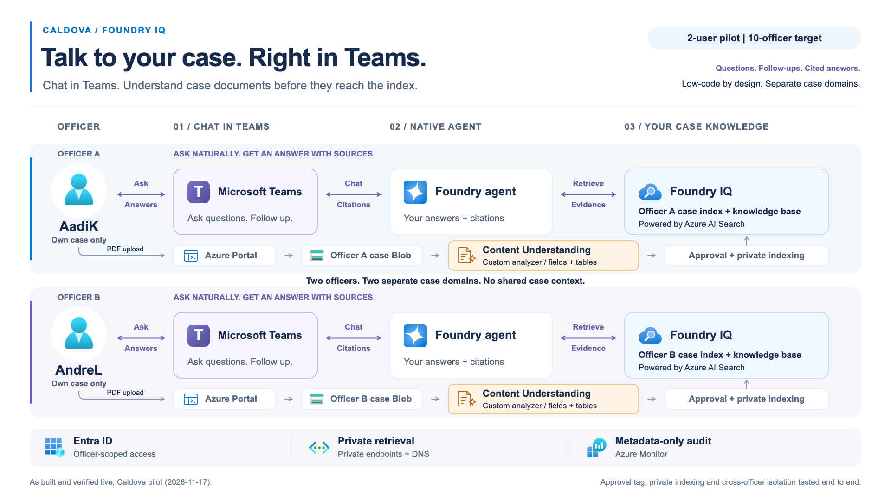
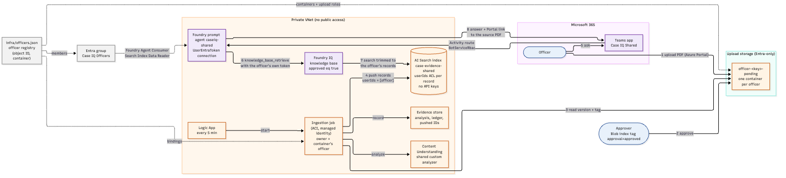
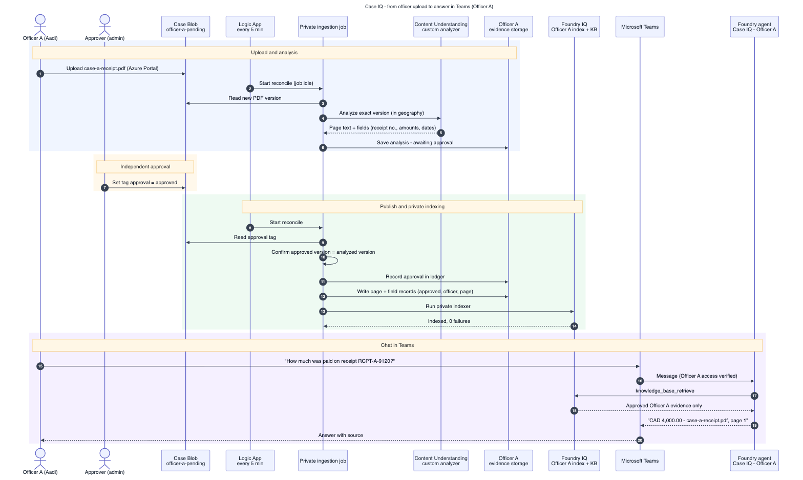
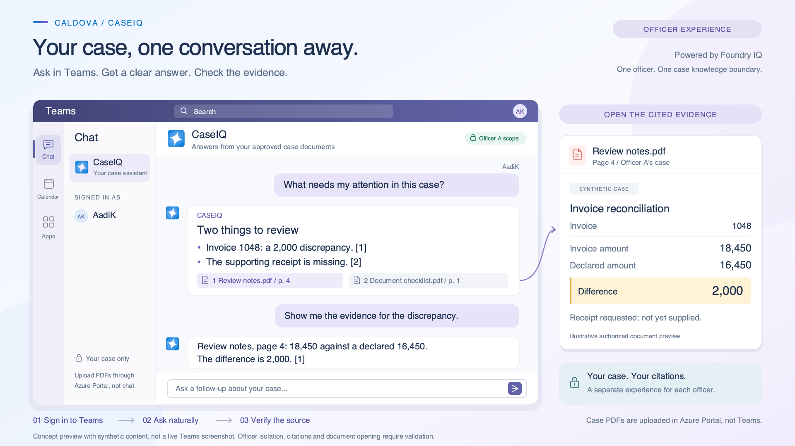

# Case IQ: private Foundry agents in Teams for tax officers

Case IQ lets tax officers ask questions in Microsoft Teams about **their own approved case documents** and get answers that cite the source PDF and page. Everything behind Teams is private: Foundry, AI Search, Content Understanding and the evidence stores have public network access disabled, and there are no API keys.

> **Synthetic data only.** This pilot runs in a commercial demo tenant with synthetic PDFs.

Two isolation models are deployed side by side:

| | Option A: one agent per officer | Option B: one shared agent (recommended for scale) |
|---|---|---|
| Isolation | Each officer has their own Foundry account, Search index and agent | One index; every record carries a native Search ACL (`userIds`), and the agent searches with the signed-in officer's own token |
| Teams | One app per officer (`Case IQ - Officer A/B`) | One app for everyone (`Case IQ Shared`) |
| Adding an officer | A new domain: Foundry, Search, Cosmos, Storage and an agent | A line in [`infra/officers.json`](infra/officers.json) plus group membership |
| Docs | [deployment.md](docs/deployment.md) | [option-b-shared-agent.md](docs/option-b-shared-agent.md) |

Neither option uses API Management or a custom bot. Teams reaches each agent through Foundry's built-in Microsoft 365 Activity route (`enable_m365_public_endpoint` with `BotServiceRbac`), the only public path on the Foundry accounts.

## How it works

**Upload and approval (both options)**
1. An officer uploads a PDF in the Azure Portal to their own container (`officer-<key>-pending`). They can't read or write anyone else's container.
2. Every 5 minutes, a Logic App starts a private ingestion job (Azure Container Instances, managed identity). The job sends the exact Blob version to a Content Understanding custom analyzer.
3. An independent approver sets the Blob index tag `approval=approved`. Officers can't see or set tags.
4. The job publishes per-page and extracted-field records to Search:
   - **Option A:** to the officer's own index, through a private indexer.
   - **Option B:** to the shared index, with `userIds = [officer object ID]` and a Portal link to the source PDF.
5. Deleting the PDF, uploading a new version or removing the tag withdraws the records on the next run.

**Chat**
- The officer asks in Teams. The Foundry prompt agent calls its Foundry IQ knowledge base (`knowledge_base_retrieve`) and answers only from the returned evidence, citing the document and page.
- **Option A:** the agent retrieves with its project identity from the officer's own domain.
- **Option B:** the agent's `UserEntraToken` connection forwards the officer's own token. With no user token, Search returns nothing.

## Diagrams

| | |
|---|---|
| Option A architecture (as built) |  |
| Option B architecture |  |
| Document lifecycle (upload → approval → indexing → Teams) |  |
| Officer experience (illustrative) |  |

Mermaid sources: [`case-iq-option-b-shared-agent.mmd`](diagrams/case-iq-option-b-shared-agent.mmd), [`case-iq-document-lifecycle-sequence.mmd`](diagrams/case-iq-document-lifecycle-sequence.mmd).

## Verified results

| Check | Option A | Option B |
|---|---|---|
| Own case answered with document and page | PASS (both officers) | PASS (test account) |
| Other officer's case refused | PASS (both directions) | PASS: other records are never returned |
| No user identity or a service principal caller | n/a (agent per officer) | PASS: 0 documents; the agent refuses service principals |
| Withdrawal and re-approval | PASS | Implemented: records deleted by exact ID |
| Teams | Used by an officer | `Case IQ Shared` works in Teams |

Officers testing option B against each other in Teams, with adversarial prompts, is the remaining manual check. See [option-b-shared-agent.md](docs/option-b-shared-agent.md#teams-test-manual).

## Repository layout

```
infra/
  main.bicep, main.parameters.json   Resource group + upload foundation (subscription scope)
  private-uploads.bicep              Upload storage (Entra-only), VNet, Blob private endpoint
  officers.json                      Officer registry: object ID, name, upload container
  officers.bicep                     Per-officer containers + upload roles; group roles (option B)
  native-iq.bicep                    Option A: one private domain per officer (uses native/domain.bicep)
  native-iq*.parameters.json         Option A dependency and runtime phases
  native-shared.bicep                Option B: shared Foundry, Search (ACL), evidence store, roles
  native-config-network.bicep        NAT, subnet and identity for the private configuration job
  native-config-job.bicep            Private ACI job that runs the configure scripts
  native-ingest.bicep                Ingestion job, custom roles, 5-minute Logic App scheduler
  native-publish-job.bicep           Option A Teams publish/package job
  native-audit.bicep                 Diagnostic settings (metadata only, no content)
  native/                            Domain, private endpoint, DNS and role modules
native/
  analyzer.json                      Content Understanding custom analyzer schema
  agent-instructions.txt             Option A agent instructions
scripts/
  native_iq.py                       Renders option A service definitions (manifests)
  configure-native-private.ps1       Option A configure, verify, end-to-end tests, Teams package
  configure-native-shared.ps1        Option B configure, isolation tests (T0–T9), package, publish
  ingest-native-private.ps1          Upload → analyze → approve → publish/withdraw reconcile
  publish-native-teams.ps1           Option A Teams publish
  sync-officer-group.ps1             Creates and syncs the "Case IQ Officers" Entra group
tests/
  test_native_iq.py                  Unit tests for the option A definitions
docs/
  architecture.md                    Design, security model and decisions
  deployment.md                      As-built inventory, runbook and option A results
  option-b-shared-agent.md           Option B as built, tests, runbook, adding officers
  option-b-shared-agent-research.md  Feasibility research and sources
  option-b-fallback-custom-engine-agent.md  Fallback design if the Teams token path fails (not built)
diagrams/                            Architecture and sequence diagrams (PNG, SVG, Mermaid)
```

## Deploy and operate

The deployment order, commands and day-to-day runbook (upload, approve, chat, add an officer) are in [deployment.md](docs/deployment.md) and [option-b-shared-agent.md](docs/option-b-shared-agent.md#runbook). In short:

1. `infra/main.bicep`: upload foundation.
2. `infra/native-iq.bicep`: option A domains. Then `infra/native-shared.bicep`: option B. Both deploy in two phases, `deployFoundry=false` then `true`.
3. `infra/native-config-network.bicep`, then `infra/native-config-job.bicep`: configure analyzers, indexes, knowledge bases, connections and agents from inside the VNet.
4. `scripts/sync-officer-group.ps1`, then `infra/officers.bicep`: officer access.
5. `infra/native-ingest.bicep` and `infra/native-audit.bicep`: ingestion schedule and audit.
6. Publish to Microsoft 365, then upload the Teams app package in the Teams admin center and assign it to the officers or the group.

Python unit tests: `python3 -m unittest discover -s tests`.

## Troubleshooting

| Symptom | Cause | Fix |
|---|---|---|
| Agent tool call fails with `tool_user_error` (option B) | Knowledge base MCP URL uses `api-version=2026-11-01-preview` | Use `2026-08-01-preview` for the connection target and `server_url` |
| Teams shows "Invalid Bot" | The agent was packaged but never published to Microsoft 365 | Run the publish step (`sharedSteps=publish`), then retry |
| "App ID already exists" when uploading the ZIP | Publishing already registered that app ID in the tenant catalog | Use the existing catalog app, or re-issue the package with a new manifest `id` |
| Agent returns `AgentIdentityDisabled` | Removing the agent in the Microsoft 365 admin center or Agent 365 deleted its Entra identity | Restore it from Entra deleted items (`POST /directory/deletedItems/{id}/restore`) |
| Content Understanding defaults reject a new model deployment | New deployments take a while to be recognized | Wait a few minutes and rerun `configure` |
| Officer can't see the shared agent | Not in the **Case IQ Officers** group, or the app isn't assigned | Add them to `officers.json`, run the group sync, assign the app |
| Redeploying the ingestion job fails | The scheduled run is in progress | Wait until the container is `Terminated`, then redeploy |
| New ACI container groups stay in Pending | Regional ACI capacity in the pilot region | Reuse the existing config job (`script`/`sharedSteps` parameters) |

> [!CAUTION]
> Publishing to Microsoft 365 and Teams means those services process agent responses under Microsoft 365 terms. Confirm compliance, data residency and governance requirements before using real data.

## License

[MIT](LICENSE)
