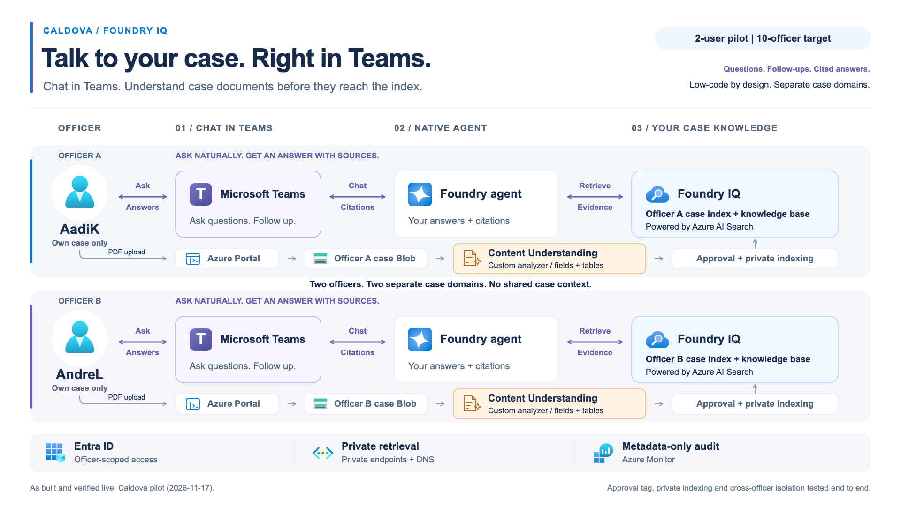
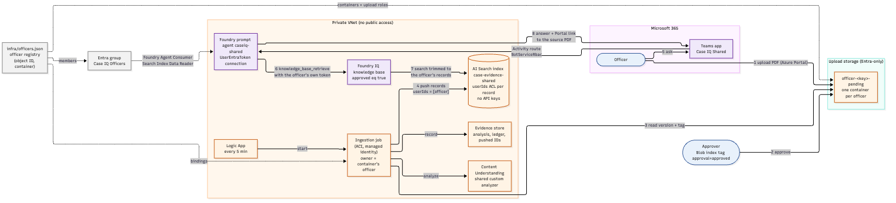
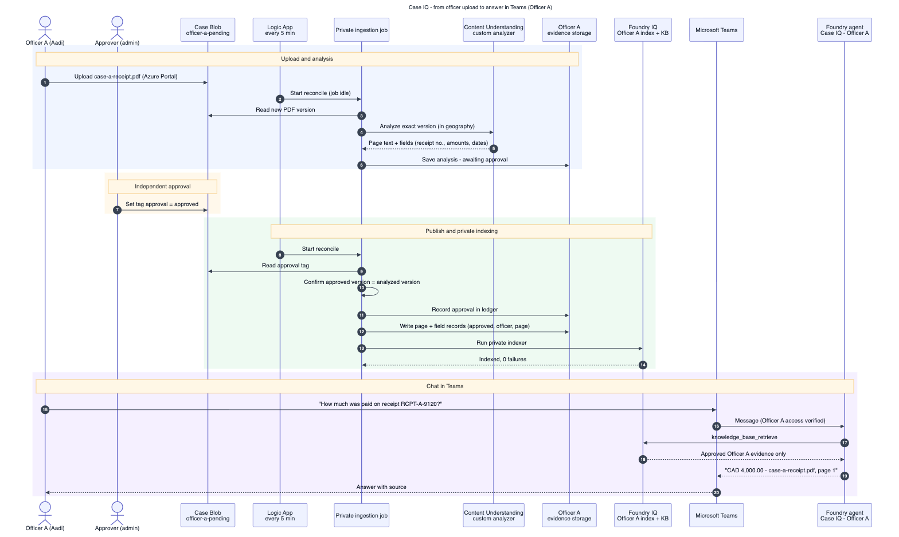

# Case IQ architecture

Status: deployed and verified in a commercial demo tenant with synthetic PDFs (2026-11-17). Option A and option B run side by side. See [deployment.md](deployment.md) and [option-b-shared-agent.md](option-b-shared-agent.md) for results.

## Goals

- Officers ask questions in Microsoft Teams and get answers **only from their own approved case documents**, citing the document and page.
- No public access to the case data: Foundry, Search, Content Understanding, evidence stores and Cosmos DB are private, and no service uses API keys.
- Low code: Azure Portal upload, Blob index tags for approval, a Logic App scheduler and native Foundry agents. There is no custom web app, bot or API Management layer.

## Option A: one domain per officer

Each officer has their own Foundry account and project, Content Understanding analyzer, evidence store, Search index, Foundry IQ knowledge base, and prompt agent `caseiq`. The agent retrieves with its project identity, which can reach only its own index. Isolation comes from separate resources and roles, so it doesn't depend on a filter or the prompt.

## Option B: one shared agent with document-level security

How it works:
- One Foundry project, one shared Content Understanding analyzer, one evidence store, and one Search index (`case-evidence-shared`) with `permissionFilterOption=enabled`.
- Every record has `userIds = [owning officer's object ID]`. Ingestion stamps the ID from the officer-to-container binding in [`infra/officers.json`](../infra/officers.json), never from document content.
- The agent `caseiq-shared` reaches the knowledge base through a **`UserEntraToken`** connection. Agent Service forwards the signed-in officer's token in `x-ms-query-source-authorization`, and Search returns only records whose `userIds` match that officer.
- Search has local authentication disabled, so there's no key that could bypass the ACL.

Behaviour without a user:
- With no user token, the index and the knowledge base return nothing.
- A service principal calling the agent is refused.

Scaling: officers are listed in the registry, and the Entra group **Case IQ Officers** carries the agent and Search roles. Adding an officer needs no new Search service, agent or Teams app. The [fallback design](option-b-fallback-custom-engine-agent.md) describes the same index fronted by our own code, in case the Teams user-token path isn't acceptable.

## Document lifecycle

1. **Upload:** the officer uploads in the Azure Portal to their own container. A scheduled private job analyzes the exact Blob version with the custom analyzer. Analysis doesn't make a document searchable.
2. **Approval:** the approver sets the Blob index tag `approval=approved`. Only the approver role can write tags, and officers can't read them.
3. **Publish:** approved analysis becomes per-page and extracted-field records with source version, SHA-256, analyzer version and approval ID. Option A indexes them privately; option B pushes them with the ACL and a Portal link to the source PDF.
4. **Withdrawal:** deleting the PDF, uploading a new version or removing the tag withdraws the records on the next run (about 5 minutes plus indexing). Answers already sent in Teams aren't retracted.

## Security model

| Principal | Can | Can't |
|---|---|---|
| Officer | Upload, read and delete in their **own** container; chat with their agent (A) or the shared agent (B); retrieve only their own records | Read other containers; approve (no tag write); see other officers' records |
| Approver | Read PDFs and set or remove the approval tag (custom role **RegIQ Case Approver**) | Upload or change PDFs |
| Ingestion identity | Read PDFs and tags, analyze with Content Understanding, write evidence stores, push to Search | Approve, change source PDFs, manage agents |
| Scheduler | Read and start the ingestion job (custom role **RegIQ Ingestion Starter**) | Change the job or its identity |
| Configuration identity | Create analyzers, indexes, knowledge bases, connections and agents | Read source PDFs or approvals |

Network:
- Every Foundry account has public network access disabled. The only public path is the source-IP-filtered, token-authorized Microsoft 365 Activity route that Teams uses. Agent endpoints keep `BotServiceRbac`, so only users with **Foundry Agent Consumer** on the project can chat.
- The upload storage account keeps public network access for Azure Portal uploads, with shared keys and anonymous access disabled.

Content safety:
- The agent instructions treat document text as evidence, never as instructions.
- The agent can call only `knowledge_base_retrieve`.

Audit: Storage, Search, Foundry and scheduler diagnostics go to Log Analytics as metadata only, with no prompts, answers or document text.

## Why no API Management

Teams reaches the private agents through Foundry's native Activity route. Search, Foundry and Storage are reached through private endpoints, so API Management isn't needed for this design. It would be added only if a non-Teams client, such as a Power Apps flow, needs a governed private API.

## Known limits

- Option B depends on preview features: the Foundry IQ remote tool connection, and the knowledge base MCP endpoint on `2026-08-01-preview`.
- Teams doesn't render Foundry citation cards. References appear in the answer text, and option B includes Portal links.
- Permissions are only as fresh as ingestion: revoking access takes effect on the next run.

## Primary sources

- [Connect Foundry IQ knowledge bases to agents](https://learn.microsoft.com/azure/foundry/agents/how-to/foundry-iq-connect)
- [MCP tool authentication (UserEntraToken)](https://learn.microsoft.com/azure/foundry/agents/how-to/mcp-authentication)
- [Document-level access control in Azure AI Search](https://learn.microsoft.com/azure/search/search-document-level-access-overview)
- [Push ACLs with the REST API](https://learn.microsoft.com/azure/search/search-index-access-control-lists-and-rbac-push-api)
- [Publish agents to Microsoft 365 with a private network](https://learn.microsoft.com/azure/foundry/agents/how-to/publish-copilot-virtual-network)
- [Content Understanding custom analyzers](https://learn.microsoft.com/azure/ai-services/content-understanding/tutorial/create-custom-analyzer)
- [Authorize Blob access in the Azure portal](https://learn.microsoft.com/azure/storage/blobs/authorize-data-operations-portal)
