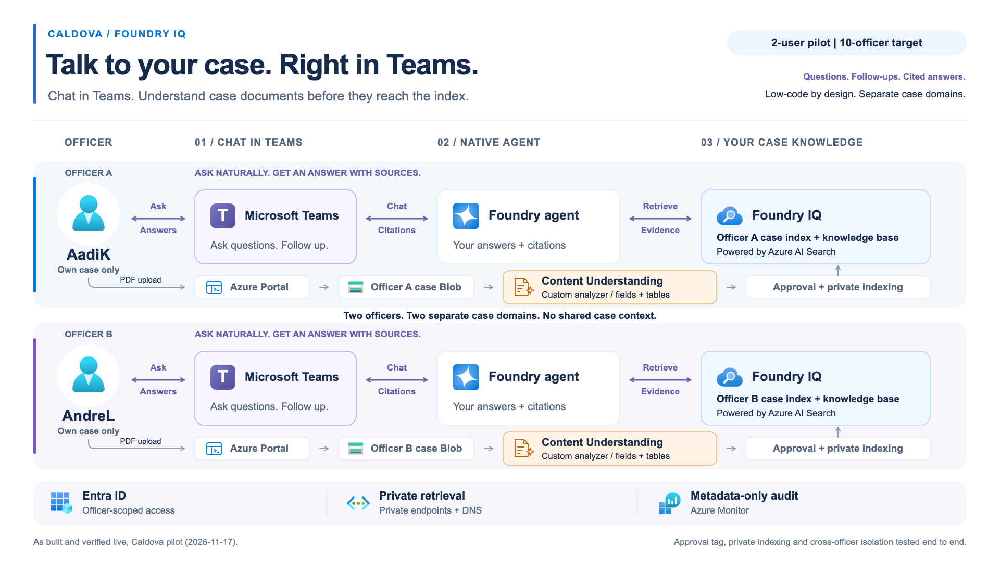
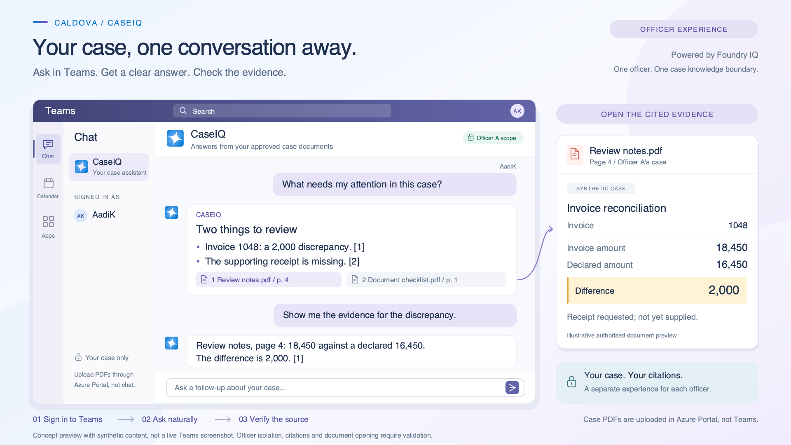
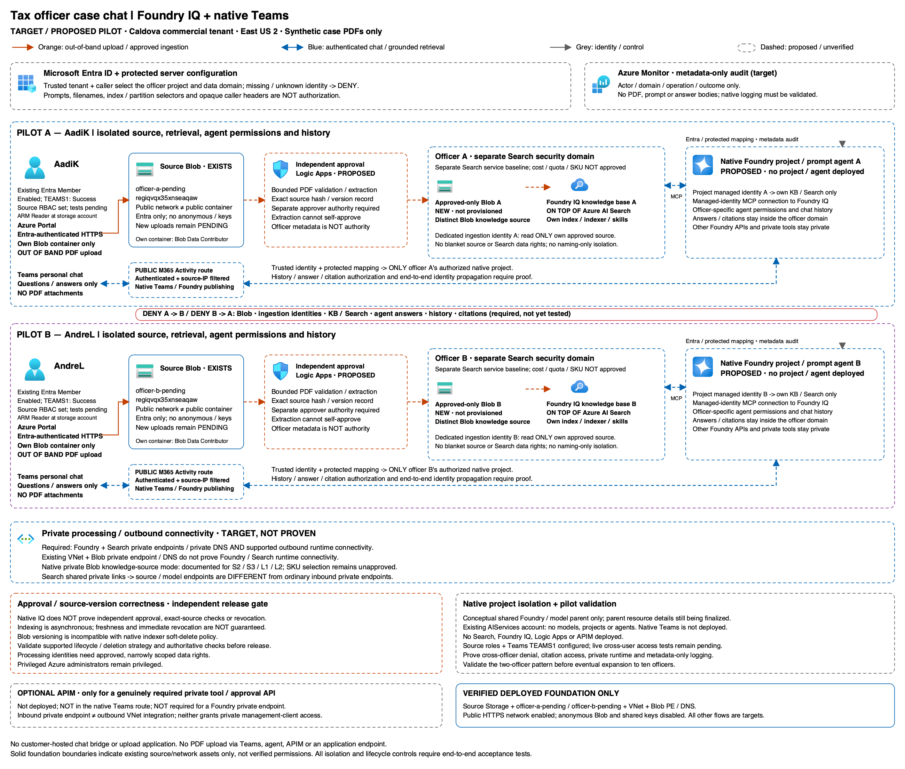

# Tax officer PDF chat: Foundry IQ pilot

Status: **Implemented and verified live for two officers** (2026-11-17).
Environment: commercial Caldova, East US 2 (Search: East US capacity fallback).
Synthetic PDFs only.
See [actual deployment results](caldova-deployment.md).

## Markitecture

[Presentation PNG](../diagrams/tax-officer-foundry-iq-markitecture-v3-content-understanding.png) |
[Editable SVG](../diagrams/tax-officer-foundry-iq-markitecture-v3-content-understanding.svg)

This simplified view separates two flows. The prominent purple conversation
path is **officer <-> Microsoft Teams <-> native Foundry agent <-> Foundry IQ**.
The grey path beneath it shows **officer -> Azure Portal -> own Blob
container -> Content Understanding custom analyzer -> approval and private
indexing -> own Foundry IQ index / knowledge base**.
Foundry IQ uses Azure AI Search. Questions, follow-ups, retrieval and cited
answers are explicitly shown, independently of the Portal upload path.
The two lanes represent separate case, index,
knowledge and agent history domains. Approval is implemented as an
approver-only Blob index tag; see the [deployment report](caldova-deployment.md).
Shared security capabilities are summarized below the lanes rather than
drawn as crossing connections. Solid arrows describe the target journey;
they do not indicate that a service or permission has been deployed or proven.
Optional APIM and detailed runtime dependencies remain in the technical view.

### Content Understanding before indexing

The selected addition is an **Azure Content Understanding custom analyzer**,
not an Azure AI Search lexical/tokenization analyzer. It processes each
officer's PDFs before their derived content is written to the Search index
used by Foundry IQ. Proposed extraction includes structured case fields,
tables and source/page references. `native/analyzer.json` now defines the
custom field schema; deployed analyzer creation remains a separate step.
Carry officer binding, source version/hash and analyzer version through the
derived outputs so citations and approval remain tied to the exact source.

Keep processing identities, outputs, sample documents and any optional
in-context-learning data within the corresponding officer security domain.
Analysis does not grant approval: failed analysis or missing independent
exact-version approval must prevent publication into the retrieval index.
The analyzer is an ingestion component, not a per-chat tool.

Prefer declarative native integration where supported. The documented
[Search Content Understanding skill](https://learn.microsoft.com/azure/search/cognitive-search-skill-content-understanding)
provides extraction/chunking but does not document a custom `analyzerId`
parameter. Do not equate that skill with invoking our custom analyzer.
Validate a supported orchestration path to the
[custom analyzer API](https://learn.microsoft.com/azure/ai-services/content-understanding/tutorial/create-custom-analyzer),
then map its output to the officer's index. Private connectivity, managed
identity permissions, supported models/region, output grounding and
additional per-page/model costs remain deployment validation items.

The native service definitions and integrity checks are implemented locally.
This does not resolve the existing revocation gate or claim a deployed
analyzer; the deployment report distinguishes local definitions from live
resources.

### Native implementation and release boundary

`infra/native-iq.bicep` adds resources alongside the upload foundation, not
through its original entry point. The dependency parameter file leaves
Foundry disabled. `infra/native-iq-runtime.parameters.json` is the separately
validated runtime stage. Neither file grants officer consumer roles or
publishes a Teams app.

`scripts/native_iq.py` renders per-officer Search index/indexer, IQ knowledge
source/base, version-addressed CU analyzer and ordinary prompt-agent
definitions from ARM outputs. The indexer reads only `approved-content`,
uses private execution and has zero tolerated failed items. IQ additionally
filters by officer and approved status; separate services and RBAC, not this
filter or agent instructions, provide the primary isolation boundary.
Foundry's privileged platform file storage uses separate accounts from
`analysis-pending`, `approved-content` and `approval-ledger`. Its required
storage-management role must not extend to the evidence/approval accounts.
Both explicit project capability hosts are now deployed and their three
own-store AAD/managed-identity bindings have been verified through ARM.
The resulting customer-owned Blob and classic Cosmos containers exist.
Native prompt-agent creation subsequently produced each own project-prefixed
`agent-definitions-v1` container. Both agents then completed an administrative
synthetic response with a successful own-IQ retrieval call, producing each
own `run-state-v1` container. This is not officer sign-in or evidence-bearing
case-retrieval proof.

`scripts/native_iq_evidence.py` checks exact source version/SHA-256,
analyzer definition hash and analysis hash before producing index records.
Its approval input must come from the protected ledger under an authenticated
reviewer identity. The function is **not** an approval workflow or an
authentication mechanism. A deployed Logic Apps ingestion/approval workflow
and ongoing withdrawal handling remain to be implemented and proven.

For private administration, `scripts/apply_native_iq.py` refuses public DNS
and HTTP redirects, uses Entra tokens in memory, checks base-analyzer model
support, and polls asynchronous analyzer creation. Before any writes, both
administrative clients verify all project capability-host bindings and each
connection's ResourceId, endpoint, category and managed-identity selection.
A misbound or missing host in either domain prevents both domains' writes.
It hosts no application.
`infra/native-config-job.bicep` and `scripts/configure-native-private.ps1`
provide a separate one-shot configuration job in ACI, not Container Apps.
This runner has configuration
authority but no source-document or approval-container data grants. Its
dedicated NAT gateway is outbound-only and adds recurring network cost;
there is no public management exception on Foundry/Search/derived Storage.
Both-domain configuration completed with exit 0 on 2026-11-17. The working
job uses a digest-pinned Microsoft PowerShell image, no volumes and no exposed
ports. `infra/native-config-runner.bicep` is the earlier failed ARM
deployment-script approach: Azure Files mounting requires shared keys, which
remain disabled. Do not retry that template as a keyless runner.
Ready immutable analyzers and matching existing agents are verified/reused,
not deleted or blindly recreated. Read-only verification compares live desired
fields; optional synthetic smoke testing requires an actual successful IQ call
and logs only response IDs/counts. Neither mode grants officer consumer access.

**Verified live:** both own-store bindings, all native service definitions,
CU extraction in the geography, tag approval, per-page publication, private
indexing, correct own-case answers with document/page references,
cross-officer refusals, withdrawal and re-approval, and Teams publishing with
BotServiceRbac. `scripts/ingest-native-private.ps1` (private ACI job started
by a Consumption Logic App) implements the ingestion/approval/withdrawal
reconcile; `scripts/native_iq_evidence.py` remains the local reference contract.
**Requires the officers:** signing in to Teams and adding their agent link.

## Officer experience

[Presentation PNG](../diagrams/tax-officer-foundry-iq-officer-experience.png) |
[Editable SVG](../diagrams/tax-officer-foundry-iq-officer-experience.svg)

This concept preview shows AadiK opening an illustrative native Teams agent
named CaseIQ, asking what needs attention, following up in natural language,
and inspecting cited evidence. All case facts and documents are synthetic.
The source preview is a storyboard of the desired evidence-checking
interaction, not a claim that this exact PDF pane or chat layout ships with
native publishing. It does not propose a custom Teams application. Validate
actual citation rendering, authorized document opening, user identity and
officer isolation before release. Uploads remain in Azure Portal, not chat.

## Detailed technical view

The detailed assets below predate the Content Understanding addition; the
markitecture and ingestion contract above are the current target for that step.

[SVG](../diagrams/tax-officer-foundry-iq.svg) |
[PNG](../diagrams/tax-officer-foundry-iq.png) |
[Editable draw.io](../diagrams/tax-officer-foundry-iq.drawio) |
[Editable Excalidraw](../diagrams/tax-officer-foundry-iq.excalidraw)
(open at <https://aka.ms/excalidraw>).

The updated diagram preserves the local Azure icons, grouped security
boundaries, orange ingestion, blue chat and grey control flows. Dashed
boundaries and flows are proposed or unverified. The drawing is not a live
inventory; see [deployment results](caldova-deployment.md) for the observed
provisioning state. A solid source boundary does not prove officer permissions.

The selected pilot users are **AadiK** and **AndreL**. Both are enabled Entra
Members with no active directory-role membership and Teams `TEAMS1`
provisioning status `Success`. Full-subscription role-assignment inspection,
including groups, shows account ARM Reader and Storage Blob Data Contributor
only on each user's own pending container. These source grants are configured;
positive and cross-user live access has not been tested. Validate this
two-officer pattern before expanding to the eventual ten officers.
The older shared AIServices account is not the native pilot runtime.
The pilot provisions separate accounts/projects instead of reusing it.
Foundry IQ definitions, Logic Apps, APIM and native Teams integration are
not deployed merely by creating the dependency resources.

Historical diagram, preserved unchanged:
[PNG](../diagrams/tax-officer-architecture.png) |
[SVG](../diagrams/tax-officer-architecture.svg) |
[draw.io](../diagrams/tax-officer-architecture.drawio) |
[Excalidraw](../diagrams/tax-officer-architecture.excalidraw).

## Foundry IQ and native project isolation

Foundry IQ is managed knowledge retrieval **on top of Azure AI Search**, not
a replacement. Each officer lane has an approved-only Blob source, native
index/indexer and existing-index knowledge source/base within an isolated
Search security domain. The dependency template creates dedicated
approved-only containers; existing `officer-a-pending` and `officer-b-pending` in
`regiqvqx35xnseaqaw` are not shown directly indexed as approved content.

The implementation selects two separate **S1** Search services in **East US**.
East US 2 rejected both new service creates for physical capacity.
Using existing-index knowledge sources avoids the S2 minimum associated
with privately autogenerated Blob knowledge sources. This is native
Foundry IQ, not a local lexical-search substitute.
Dedicated ingestion identities read only their own approved
source. Each native Foundry project managed identity uses an MCP connection
to query only its own knowledge base/Search domain. Different names under
a broadly privileged identity do not establish isolation. Agent permissions,
history, answers and citations must remain officer-specific; A-to-B and B-to-A
access must deny. The runtime stage uses separate Foundry accounts/projects
with regional Standard GPT-5.1 and embedding model deployments.

Private endpoints/private DNS and outbound runtime connectivity remain
requirements, not a proven runtime. Native private Blob knowledge-source mode
is documented for S2/S3/L1/L2; it is not the selected path. Search shared private
links to source/model endpoints are distinct from ordinary inbound private
endpoints. Existing Blob private connectivity proves neither Foundry nor
Search connectivity.

## Low-code implementation

Prefer service configuration over a custom application:

| Capability | Preferred service |
| --- | --- |
| PDF upload | Azure Portal and container-scoped Entra roles |
| Document analysis before indexing | Azure Content Understanding custom analyzer; officer-isolated outputs |
| Knowledge retrieval and indexing | Foundry IQ existing-index knowledge sources; private approved-Blob indexers |
| Approval and orchestration | Logic Apps with narrowly scoped managed identities |
| Agent and Teams publishing | Native Foundry prompt agent and Activity publishing |
| Private API gateway, if required | APIM policies, private endpoint and outbound VNet integration |
| Audit | Azure Monitor with content logging excluded |

These are implementation preferences, not deployed capabilities or permission
grants. A native indexer or an agent prompt alone does not satisfy exact-source
approval and immediate revocation. Prove these boundaries before release;
identify any unavoidable small code component explicitly rather than rebuilding
the entire application.

Do not start new development on Foundry's visual workflows: Microsoft documents
their retirement on December 1, 2026. Use supported Logic Apps orchestration
where feasible.

### Where APIM fits

Foundry, Search and Blob can have their own private endpoints without APIM.
APIM is useful when private tool or approval APIs need a managed gateway,
authentication and routing policies.

For that role, APIM Standard v2 can combine an **inbound private endpoint**
with **outbound VNet integration** to reach private backends. Configure
private DNS and backend authorization separately. An inbound private endpoint
alone does not make the backend connection private.

Retain native Teams-to-Foundry Activity publishing. Teams cannot directly
reach a private-only APIM gateway; adding one does not remove the scoped
public M365 Activity route or solve private management-client access.
APIM appears only as an optional dashed callout, not a native Teams route
component. It is not deployed; its concrete private-tool/approval API role
remains undecided. It is not required for Foundry's own private endpoint.

## Upload path

Officers upload PDFs out of band through the public Azure Portal directly into
their assigned Blob containers. No PDF attachments pass through Teams,
Copilot Studio, Power Automate or an application upload endpoint.

Public Blob **network connectivity** is allowed; anonymous access is not.
Require Entra authorization, `allowSharedKeyAccess: false`,
`allowBlobPublicAccess: false`, `defaultToOAuthAuthentication: true`,
HTTPS and TLS 1.2 or higher. Each container has `publicAccess: None`.
No VPN or private desktop is required for Portal uploads.

Give each officer Storage Blob Data Contributor at their container only and
ARM Reader at the account for Portal navigation. The data role includes read,
write and delete; it is not upload-only. Inspect inherited and group grants:
a narrow grant does not cancel broader access. Privileged administrators can
change grants; do not claim isolation from them.

The existing Blob private endpoint can remain for private processing. Do not
remove private service networking merely because public uploads are permitted.

## Chat path

Teams personal chat uses native Foundry Activity publishing, with the
source-IP-filtered M365 public Activity route and BotServiceRbac/Entra
authorization. Other depicted Foundry APIs and tools remain private.

Do not introduce a custom Bot Connector application, proxy, Container Apps
environment or replacement chat host. A model deployment alone is not a
Foundry agent and cannot substitute for the publishing flow.

## Authorization and officer security domains

Authorization is deterministic and precedes retrieval:

1. Validate trusted tenant and caller identity through the supported
   Teams/Foundry path. Missing or unknown identity denies retrieval.
2. Resolve the officer's container and Search domain from protected,
   server-owned configuration. A prompt, email or caller-supplied partition
   is never identity or authority.
3. Use a separate Search service/security domain and narrowly scoped
   processing identity per officer. No shared identity with blanket source
   access, shared vector store, cross-officer cache or conversation history.
4. Require independently authorized approved content and authoritative
   source hash/version checks before release. Validate how the supported
   native topology enforces them; a prompt or filter alone is insufficient.
   The model cannot select permissions, bypass approval or supply
   authoritative source/citation URLs.
5. Authenticate citation access as the officer; verify the approved source
   again. No SAS links or account keys.

The diagram's separate native projects must realize these boundaries using
supported Foundry capabilities. Prove trusted caller propagation and
project/agent permissions; do not invent identity headers or assume that a
service credential is a delegated officer credential.

## Ingestion and approval

New Portal uploads remain pending. Validate bounded PDF size/page count,
synthetic content and parsing time before extraction or indexing. Document
text is untrusted data, never instructions. Retain the fixed system message.

The diagram explicitly leaves two authorization gates unresolved:

- Dedicated per-officer machine read access is an exception to human-only
  access and requires approval before granting it.
- Independent approval authority must be selected. A metadata-only reviewer
  need not receive routine PDF content access.

Record approval for an exact immutable source hash/version in a separately
controlled record. Extraction cannot approve documents. Officer-editable Blob
metadata is not proof of approval. Changed, withdrawn or rejected content must
invalidate retrieval and derived data.

Independent approval/source-version controls are requirements, not proven
native IQ features. Native indexing is asynchronous; freshness and immediate
revocation are not guaranteed. Blob versioning is incompatible with the
native indexer soft-delete policy. Validate the supported lifecycle/deletion
strategy and authoritative checks before declaring these acceptance tests met.

## Audit

Azure Monitor records actor, partition, operation and outcome, not PDF,
prompt or answer bodies. Verify the logging behavior of the actual native
runtime as well as application logging.

## Acceptance tests

- Officer A uploads/reads their own container; B is denied via Portal and REST,
  and vice versa. Shared-key and anonymous access fail.
- Public authenticated upload works without private browser connectivity.
- Each processing identity is denied the other officer's Blob/Search domain.
- Invalid/missing identity and forged partition selectors deny before retrieval.
- Pending, rejected, changed and withdrawn versions never appear in answers.
- Approval revocation during inference prevents releasing a stale answer.
- Citation access authenticates the officer and checks the exact approved source.
- Malformed/oversized PDFs and malicious document instructions fail safely.
- Private service networking works; only the intended M365 Activity route is
  publicly reachable on Foundry.
- Native Teams conversation, agent identity and user authorization are tested.
  An anonymous 403 or mocked unit test is not a cross-user end-to-end test.
- Audit inspection finds metadata only.

These are completion requirements, not claims that the current deployment
has passed them.

## Primary sources

- [Foundry IQ overview](https://learn.microsoft.com/azure/foundry/agents/concepts/what-is-foundry-iq)
- [Foundry IQ managed-identity MCP connection](https://learn.microsoft.com/azure/foundry/agents/how-to/foundry-iq-connect)
- [Blob knowledge sources and private connectivity](https://learn.microsoft.com/azure/search/agentic-knowledge-source-how-to-blob)
- [Native Foundry publishing and scoped public Activity route](https://learn.microsoft.com/azure/foundry/agents/how-to/publish-copilot-virtual-network)
- [Foundry hosted runtime and native Activity bridging](https://learn.microsoft.com/azure/foundry/agents/concepts/hosted-agents)
- [AI Search tool, private authentication and fixed filters](https://learn.microsoft.com/azure/foundry/agents/how-to/tools/ai-search)
- [Portal Entra authorization](https://learn.microsoft.com/azure/storage/blobs/authorize-data-operations-portal)
- [Container-scoped Blob roles](https://learn.microsoft.com/azure/storage/blobs/assign-azure-role-data-access)
- [APIM inbound private endpoint](https://learn.microsoft.com/azure/api-management/private-endpoint)
- [APIM outbound VNet integration](https://learn.microsoft.com/azure/api-management/integrate-vnet-outbound)
- [Native Blob indexing](https://learn.microsoft.com/azure/search/search-how-to-index-azure-blob-storage)
- [Indexer change/deletion detection and versioning limitation](https://learn.microsoft.com/azure/search/search-how-to-index-azure-blob-changed-deleted)
- [Logic Apps managed identities](https://learn.microsoft.com/azure/logic-apps/authenticate-with-managed-identity)
- [Foundry visual workflow retirement](https://learn.microsoft.com/azure/foundry/agents/concepts/workflow)
