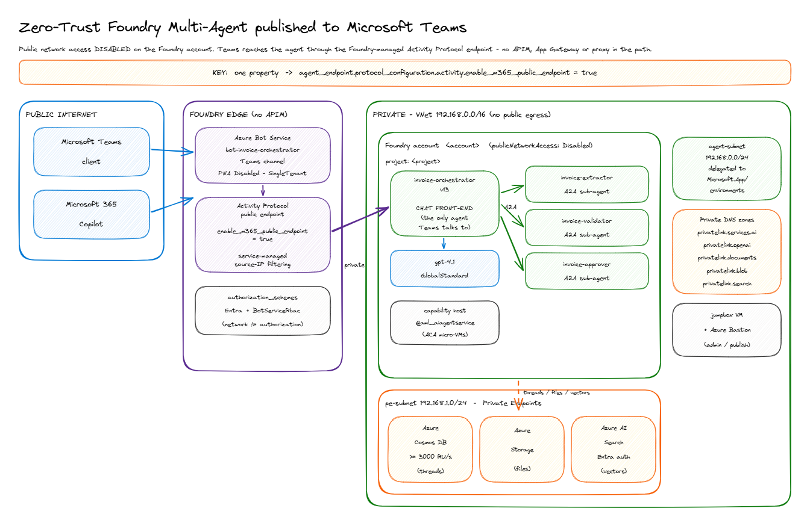
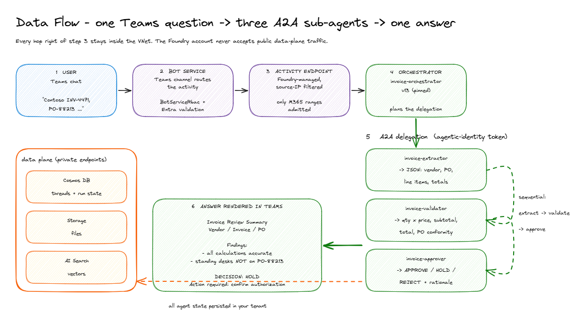
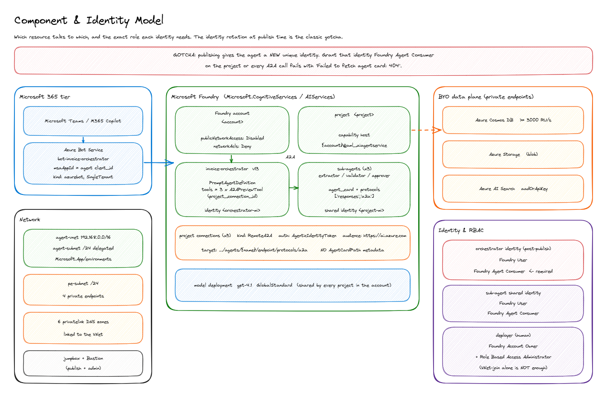

# Multi-agent A2A orchestration behind a private endpoint, published to Teams

A companion to the [no-APIM Teams publishing pattern](../README.md) in this repo.

That walkthrough publishes **one** private-networked Foundry agent to Microsoft Teams. This
folder takes the same zero-trust posture and puts a **multi-agent system** behind it: a single
chat-facing **orchestrator** that delegates to three specialist sub-agents over the
**Agent2Agent (A2A)** protocol — all inside the virtual network, with
`publicNetworkAccess` still **Disabled** on the Foundry account.

To the user it is one agent in Teams. Behind the endpoint it is four.



---

## What gets built

| Agent | Role |
|---|---|
| `invoice-orchestrator` | The only agent Teams talks to. Plans the work and calls the others as A2A tools. |
| `invoice-extractor` | Returns structured JSON from raw invoice text. |
| `invoice-validator` | Checks line maths, subtotal, total and PO conformity. |
| `invoice-approver` | Issues APPROVE / HOLD / REJECT with a rationale. |

Delegation happens **server-side**, inside Foundry. That matters: Teams invokes the Activity
Protocol endpoint, so any orchestration that lives in a local client process would never run.
Client-side frameworks are great for development, but to front a multi-agent system with Teams
the fan-out has to be in the published agent itself.

### Example

Paste an invoice into the Teams chat:

> Contoso Office Supplies, INV-4471, PO PO-88213. 10 Ergonomic chair @220=2200;
> 4 Standing desk @610=2440; 25 Notebook @12=300. Subtotal 4940, Tax 419.90,
> Shipping 75, Total 5434.90. Standing desks were NOT on PO-88213.

The orchestrator extracts, validates, and decides:

> **Findings:** all calculations accurate; standing desks (4 units, $2440) are present on the
> invoice but not authorized on PO-88213.
> **Decision: HOLD** — payment placed on hold due to non-PO items.

---

## Data flow



Everything to the right of step 3 stays inside the VNet. The Foundry account never accepts
public data-plane traffic; only the Activity Protocol route is opened to Microsoft 365, using
Foundry-managed source-IP filtering.

---

## Components and identity



---

## Two findings that cost real time

### 1. Publishing rotates the agent identity

Before publishing, every agent in a project **shares one identity**. After publishing, the
published agent receives **its own new identity** — with no role assignments. Every A2A call
then fails with:

```
Failed to fetch agent card: 404 (Not Found).
The target A2A agent card was not found or is not accessible to the configured identity.
```

The 404 is misleading: the card exists and the target is healthy. The *caller* simply cannot
read it. Grant the **new** identity `Foundry Agent Consumer` (plus `Foundry User`) on the
project and the delegation starts working. Re-run
[`05-grant-agent-identity.ps1`](scripts/05-grant-agent-identity.ps1) after any publish.

Use [`06-show-identity.ps1`](scripts/06-show-identity.ps1) to read the current identity.

### 2. Never set an agent card path for a Foundry-agent target

Foundry resolves its own default card path for Foundry-hosted targets (today
`/agentCard/v0.3`). Supplying one — on the tool as `agent_card_path`, or on the connection as
`AgentCardPath` metadata — returns:

```
Agent card path is invalid for a Foundry agent.
Either fix the agent card path or remove it to use the default agent card path.
```

Leave it out. The two errors look unrelated but they bracket the same step, and flipping
between them is a reliable sign you are close.

---

## Layout

```
multi-agent/
├── README.md                 you are here
├── SETUP.md                  step-by-step build
├── diagrams/                 Excalidraw sources + PNG renders + generator
└── scripts/
    ├── 00-variables.sample.ps1   copy to 00-variables.ps1 (gitignored)
    ├── 01-create-subagents.ps1
    ├── 02-enable-incoming-a2a.ps1
    ├── 03-create-a2a-connections.ps1
    ├── 04-create-orchestrator.py
    ├── 05-grant-agent-identity.ps1   <- the step people miss
    ├── 06-show-identity.ps1
    ├── 07-invoke-orchestrator.py
    ├── 08-enable-m365-endpoint.ps1
    └── 09-publish-to-m365.ps1
```

Diagram sources are editable at [excalidraw.com](https://excalidraw.com) (or your internal
instance). Regenerate the `.excalidraw` files with `python diagrams/gen.py`.

---

## Scope

**This shows**

- Server-side multi-agent delegation over A2A between Foundry-hosted prompt agents
- A private-networked orchestrator published to Teams with no APIM, App Gateway or proxy
- The RBAC and connection shape that A2A actually requires

**This does not show**

- Making Teams private. Teams and Microsoft 365 remain public-network products.
- Cross-tenant or third-party A2A endpoints. Every target here is a Foundry agent in the same project.
- Production hardening: no retries, no evaluation, no human-in-the-loop gate on the approval decision.

> **Note on previews.** The A2A tool has a GA form (`a2a`, protocol 1.0) and a preview form
> (`a2a_preview`, protocol 0.3). The scripts use `A2APreviewTool`, which is what worked
> end-to-end against Foundry-agent targets at the time of writing. Check the current
> [A2A tool documentation](https://learn.microsoft.com/en-us/azure/foundry/agents/how-to/tools/agent-to-agent)
> before building on it.

---

## Reference

- [Enable incoming A2A on a Foundry agent](https://learn.microsoft.com/en-us/azure/foundry/agents/how-to/enable-agent-to-agent-endpoint)
- [Connect to an A2A agent endpoint](https://learn.microsoft.com/en-us/azure/foundry/agents/how-to/tools/agent-to-agent)
- [Agent2Agent (A2A) authentication](https://learn.microsoft.com/en-us/azure/foundry/agents/concepts/agent-to-agent-authentication)
- [Set up private networking for Foundry Agent Service](https://learn.microsoft.com/en-us/azure/foundry/agents/how-to/virtual-networks)
- [`microsoft-foundry/foundry-samples` — A2A delegation sample](https://github.com/microsoft-foundry/foundry-samples/tree/main/samples/python/hosted-agents/agent-framework/a2a/01-delegation)
- [Microsoft Agent Framework](https://github.com/microsoft/agent-framework)

## License

[MIT](../LICENSE)
